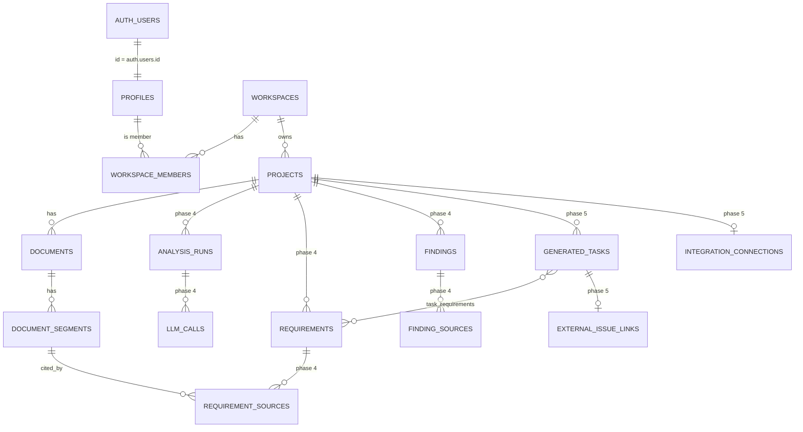

# Data model

Postgres on Supabase. Schema is defined in `apps/api/src/db/schema.ts` (Drizzle); migrations live in
`apps/api/drizzle/` and are never edited after they are applied.

All access goes through NestJS. Row Level Security is **enabled on every table with no policies**, so the
browser (Supabase `anon` / `authenticated` roles) cannot read or write any row directly. NestJS connects
with a server-side connection string and enforces ownership itself (see ADR 0003).

## ERD (full MVP)

Built so far: `profiles`, `workspaces`, `workspace_members`, `projects` (phase 2) and `documents`, `document_segments` (phase 3). The rest arrive in the phase shown.

## Phase 2 tables

| Table               | Columns                                                                                                                      | Notes                                                                                |
| ------------------- | ---------------------------------------------------------------------------------------------------------------------------- | ------------------------------------------------------------------------------------ |
| `profiles`          | `id` (pk, fk `auth.users.id`, cascade), `email`, `display_name`, `created_at`                                                | Created on the user's first API request, in the same transaction as their workspace. |
| `workspaces`        | `id` (uuid pk), `name`, `created_at`                                                                                         | Every user gets a personal workspace. Teams come later without a schema change.      |
| `workspace_members` | pk (`workspace_id`, `user_id`), `role` (`owner`), `created_at`                                                               | Index on `user_id`: "which workspaces am I in" is asked on every request.            |
| `projects`          | `id` (uuid pk), `workspace_id` (fk, cascade), `name`, `description`, `created_by` (fk, set null), `created_at`, `updated_at` | Always reached through a workspace the caller belongs to.                            |

## Phase 3 tables

| Table               | Columns                                                                                                                                                                          | Notes                                                                                                                           |
| ------------------- | -------------------------------------------------------------------------------------------------------------------------------------------------------------------------------- | ------------------------------------------------------------------------------------------------------------------------------- |
| `documents`         | `id`, `project_id` (fk, cascade), `name`, `mime`, `size`, `sha256`, `storage_key`, `status`, `error_code`, `page_count`, `token_count`, `uploaded_by` (fk, set null), timestamps | `mime` is decided from the file's content, never from the browser's header. Only metadata lives here; the bytes are in storage. |
| `document_segments` | `id`, `document_id` (fk, cascade), `index`, `page` (null for DOCX/TXT), `text`, `token_count`; unique (`document_id`, `index`)                                                   | The unit AI answers cite. A quote is verified against exactly one segment.                                                      |

`documents.status` is its own small state machine: `uploaded` → `extracting` → `extracted` or `extraction_failed`
(a failed document can go back to `uploaded` by a retry). `error_code` holds a user-facing code such as
`PDF_NO_TEXT_LAYER` (see `@copilot/contracts`).

The job queue (pg-boss) keeps its own tables in a separate `pgboss` schema in the same database.

## Rules

- **Ownership lives in `workspace_members`.** A project belongs to a workspace, never directly to a user.
  Adding teams later is new rows and a new role value, not a rewrite (ADR 0002).
- **Cascades:** deleting a workspace deletes its members and projects, a project its documents, a document its segments; deleting an auth user deletes the
  profile and memberships. `projects.created_by` is set to null so history survives a removed user.
- **Timestamps** are `timestamptz`; `updated_at` is set by the application on update.
- **IDs** are UUIDs generated by the database, so they are not guessable or sequential.
- **Another user's data returns 404, not 403**, so the API does not confirm that an id exists.
- **Files are not cascaded by the database.** Deleting a document or a project removes the rows first and then
  the files, so a leftover file (harmless) is possible but a row pointing at a missing file is not.

## Analysis (phase 4)

| Table                 | Holds                                                                                                                                                                                                                                                                                    |
| --------------------- | ---------------------------------------------------------------------------------------------------------------------------------------------------------------------------------------------------------------------------------------------------------------------------------------- |
| `analysis_runs`       | One analysis of a project: status (`queued`, `running`, `succeeded`, `failed`, `cancelled`), prompt version, model, tokens, cost, requirements found, error code. A partial unique index allows one `queued`/`running` run per project                                                   |
| `requirements`        | What the AI proposed and a person reviews: `number` (REQ-001, unique per project and never reused), title, description, type, priority, status (`ai_suggested`, `confirmed`, `needs_clarification`, `rejected`), `edited_by_user`, confidence, AI comment, `source_unverified`, `run_id` |
| `requirement_sources` | Where a requirement comes from: document, segment (set null if the text is re-extracted), page and quote (copied, so they survive)                                                                                                                                                       |

See `docs/analysis-pipeline.md` for the flow and the rules.
